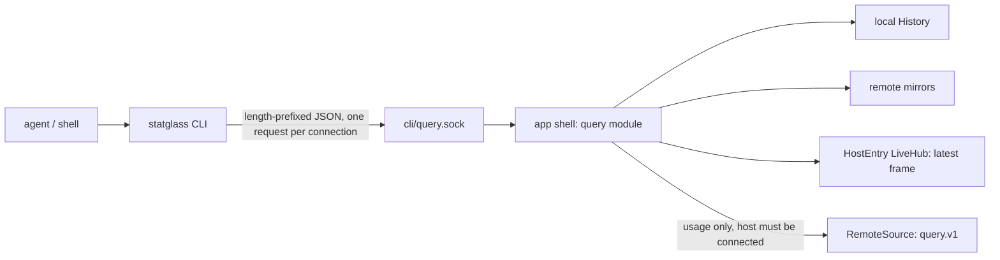

# RFC: `statglass` command-line tool for agents

Status: Draft, revised after devil's-advocate review (see "Review outcome"). Date:
2026-11-03. Decision entry: D-126 (proposed). Owner questions resolved (see the end).

## Problem

StatGlass knows what happened on every machine it watches: an hour of 1 s samples, rolled-up
history for weeks, detector events, per-app usage, and mirrored history for remote Macs and
Linux boxes, including ones that are offline right now. The only way to get at any of it is
the GUI. A developer who asks a coding agent "my build got slow around 3pm, what was eating
CPU?" or "is m1-linux's disk filling up?" gets an agent that runs `top` and `df` on the
current moment, or SSHes into the box, and has no idea what happened at 3pm.

There is no programmatic surface. The two existing sockets are wrong for this: `metrics.sock`
serves only this host's data to a remote controller over the CBOR session protocol, and
`control.sock` handles helper status and settings. Neither can answer a question about a
mirrored host, and neither should grow into a general query API.

## Who and what job

The primary reader is a coding agent (Claude Code, Codex, Cursor) running in the user's shell
on the Mac where StatGlass runs. A person at a terminal is the second reader, and a shell
script the third. Following `../stacks`, every command is designed for the agent first, and
human output is a readable rendering of the same result.

Jobs, in the order they matter:

1. When something on one of my machines misbehaved, I want my agent to find out what happened
   and when, so I can fix the cause instead of guessing from the current moment.
2. When I'm about to do something heavy (a build, a model run, a Docker prune), I want my agent
   to check a host's current state and recent trend, so it can pick a host or warn me.
3. When I write a script or a cron job, I want stable machine-readable output, so I don't
   have to scrape the GUI or the SQLite files.

Success: from a cold start, where the agent knows only that `statglass` exists, Claude Code
answers each of the five questions under "Verification" in three commands or fewer, no single
command prints more than about 4,000 tokens in agent mode, and the agent never reports
"nothing happened" for a span StatGlass has no data for.

## The DX/AX bar: what `stacks` and `rr` do

Both CLIs were exercised for this RFC (stacks 0.7.0, rr from Homebrew). These are the
behaviors this CLI copies.

`stacks` with no arguments prints an agent guide: what the tool is for, the loop to follow
(search, show, new, verify), the rules an agent must not break, and where to look next (`stacks
<command> --help`, `stacks schema <name>`). An agent that has never seen the tool can work from
that screen alone. `stacks --help` ends with a "Start here (agents)" footer that repeats the
loop in two lines.

`stacks` picks one of three audiences per invocation: `--json` writes exactly one result object
to stdout; otherwise human output only when stdout is a terminal, no agent marker is set
(`CLAUDECODE`, `CODEX_*`, `CURSOR_AGENT`, `AI_AGENT`) and `CI` is unset; everything else gets
agent output, which is the human rendering with progress, logs, color and redundant lines cut.
The three modes never differ in exit code or side effect.

On failure, `stacks --json` leaves stdout empty and writes one envelope as the last stderr line:
`{"error":{"tag","message","retryable","next","details"}}`. Messages are fixed per tag so an
agent can match them; context goes in a closed `details` struct; `next` names a real command.
A typo (`stacks shwo`) gets `Did you mean: show?` from one shared edit-distance helper, with
the same suggestions in `details.suggestions`. Each exit code means one next action, and a
published code never changes meaning.

Every subcommand's `--help` documents every flag, states every exit code in prose, and ends
with examples, including the `--json` form an agent would run. `stacks schema` lists a JSON
Schema for every `--json` result, every live event and the error envelope. `stacks doctor`
reports version, paths and configuration in text and `--json`. `stacks skill install` installs
the bundled agent skill so an agent discovers the tool without being told.

`rr` adds three things. Every error carries a `suggestion`, and `rr doctor` exists for "why
doesn't this work". `rr monitor --once --json` is the closest prior art to this CLI: a one-shot
fleet snapshot built for scripts and agents, which takes two samples a second apart so rates
are real rather than zero, and whose help says outright which mode is for agents. And rr ships
a Claude Code plugin whose skill carries a `reference/` directory for JSON output and error
codes, so the CLI's help can stay short.

Two deliberate differences. rr wraps success as `{success, data}` on stdout; this CLI follows
stacks and writes the bare result, so stdout decodes directly with the command's schema. And
rr's `monitor` defaults to a text table while the rest of rr defaults to JSON; this CLI has one
output rule for every command.

## Proposal

### Shape

A Rust binary, `statglass`, shipped inside the app bundle and linked onto PATH. It is a client:
it never opens SQLite, never starts a collector, never opens its own connection to a remote
host. It asks the running app over a new owner-only Unix socket, and the app answers from the
same code paths the dashboard uses. History and events for remote hosts come from their
mirrors, so offline hosts still have them. Per-app usage for a remote host is asked of the host
over its existing session, so it needs the host connected (see `top`).



Rust was chosen over an Effect TypeScript CLI like stacks. A self-contained TS binary
(`bun build --compile`) is about 55 to 60 MB per architecture against a 36 MB app, needs the
JIT entitlement under hardened runtime, and would hand-mirror types Rust already owns. The
helper binary this CLI sits next to is 550 KB.

### Crates and ownership

`statglass-query` (new) owns the public query contract: `QueryRequest`, `QueryResponse` and
their result DTOs, the blocking client, and `schemars` JSON Schemas. It depends on
`statglass-schema`, serde, serde_json and schemars. No tokio, store, engine or remote
dependency, so the CLI cannot reach storage and stays small.

The DTOs are a deliberate second set of types, not a mirror of `statglass-schema` or
`src-tauri/src/ipc.rs`. The orphan rule stops `statglass-query` from deriving `JsonSchema` for
schema types, several result types live only in the app shell (`RemoteHostStatus`,
`SeriesStats`), and the GUI's IPC types change whenever the dashboard needs them to. The CLI
contract evolves under its own rule (additive only, below), and the app's query module maps
internal types to DTOs in one place.

`statglass-cli` (new) is the binary: clap with long help, the audience rule, rendering, the
envelope and exit codes, guide and skill text. It depends on `statglass-query` and
`statglass-schema`.

`src-tauri` gains a `query/` module that binds the socket and has one handler per request,
calling the internals the Tauri commands call (`AppState::history_for`, the events reader,
`RemoteSource::usage_by_app`, durable usage), not the commands themselves.

`scripts/architecture/crate-edges.json` gains `statglass-query -> [statglass-schema]`,
`statglass-cli -> [statglass-query, statglass-schema]` and `statglass -> [statglass-query]`.
`statglass-remote` is unchanged and does not depend on the CLI contract. The query socket's
framing (u32 big-endian length plus JSON) is the same shape as `control.sock`'s but is written
twice: the server side reuses `statglass-remote`'s tokio helpers (`bind_private`, `same_uid`),
and the client is about 40 lines of blocking std I/O in `statglass-query`. Sharing it would
force tokio into the client or a remote-session crate onto the public contract.

The client does not check the peer's credentials (`UnixStream::peer_cred` is unstable in std,
and `getpeereid` would mean unsafe FFI under `rules/rust/platform.md`). It checks the socket
directory instead: owned by the current uid, mode 0700, socket file 0600, before connecting.
Only the same user can create a socket there, which is the property the peer check gives.

### New engine and store work

The commands need four things that do not exist today. Each is small, and each is owned by the
crate that owns the data.

1. Per-series summaries (`statglass-store`). `range_stats` takes unlabelled metrics only and
   filters by metric id (`reader/stats.rs:74`), so it would blend every `cpu.load{core}` into
   one number, and it has no min, last or time of max. A new `series_summary` reader returns,
   per `SeriesKey`: min, max with the start and width of the bucket it fell in, span-weighted
   mean over measured time, last value with its time, and measured time. It reuses
   `range_stats`'s measured-time rule (gaps applying to the module are not measured).
2. A sync watermark for mirrors (`statglass-remote`, mirror side). `RemoteHostStatus` has
   `last_seen_ms` and a `RemoteSync` state but no time the mirror is complete through, and an
   unsynced span has no rows and no `Gap`. The mirror reports `synced_through_ms`: the end of
   the newest bucket committed with its cursor, per tier. The query module turns the span
   between it and the end of the range into a gap with reason `not_synced` in the CLI's
   output. This is a CLI-level gap; nothing is written to the store.
3. Interned series listing (`statglass-store`), for `metrics --host`: which series keys a host
   has rows for.
4. Unreadable event count (`statglass-store`). `EventDetail` has no Unknown variant and the
   reader skips rows from newer builds (`event.rs:28-31`, D-083), so an event a newer remote
   host recorded disappears silently. The reader returns how many rows it skipped, and
   `events` reports `unreadable: n` with a line in agent text.

### The socket

`<app_data>/cli/query.sock`, bound with `bind_private` (directory 0700, socket 0600, peer uid
checked on every accept). One request per connection, request at most 16 KiB, response at most
4 MiB.

Deadlines: 10 s for local and mirror reads, 20 s for requests forwarded to a remote host, which
is longer than the session's own 15 s `ANSWER_WITHIN` so the typed busy or unavailable answer
arrives before the socket gives up. The client waits 25 s.

Four requests at most at once; a fifth gets `Busy`. A slot is released when the handler's
blocking work actually finishes, not at its deadline, because `spawn_blocking` SQLite work
cannot be cancelled. That keeps `Busy` honest and stops retrying agents from piling abandoned
reads onto the readers the dashboard uses. Handlers run on the blocking pool, never on the
sampler. An idle listener costs nothing against the idle-CPU budget; the coalition bench
confirms that before landing.

Socket discovery: the CLI resolves its own executable through the symlink, reads
`CFBundleIdentifier` from the enclosing bundle's `Info.plist`, and uses that app's data
directory. A dev build (`com.tryopendata.statglass.dev`) therefore finds the dev app's socket,
and a release build the release app's. `STATGLASS_APP_ID` overrides it for tests.

### Versioning

Every request carries `api: 1`, and every response carries `api` and `app_version`. The
contract follows D-117's rule: fields and enum values are added, never renamed or removed;
new optional fields are `Option`, so older clients ignore them; enums that cross the contract
are strings in JSON and the guide tells agents to treat an unknown value as "other". `api`
increments only for a breaking change, which pre-v1 is allowed but still costs a release note.
An operation the app does not know is answered `Unsupported`, never a dropped connection.

Within an install the CLI and the app come from one bundle, so skew happens only when an update
has replaced the bundle while the old app is still running. The CLI reports that as
`AppOutdated`.

### Access default

The socket is on by default, with a Settings toggle, "Allow command-line access", that turns
it off (the socket is not bound and the CLI reports `AccessDisabled`).

This is a different exposure from D-104's opt-in `metrics.sock`. That socket lets other
machines read this Mac; this one lets local processes running as the same user read what
StatGlass knows. Most of that is already readable in the user's SQLite files. Not all of it:
through the existing sessions, `top` asks connected remote hosts for per-app usage that lives
only on those hosts, and makes them do the work of answering. Those are hosts the user paired,
the requests are read-only, and the remote side already rate-limits with `Busy`. The owner
chose on by default (2026-11-03) on that basis.

### Commands

Every command takes `--json`, and `--host` and the time flags where they apply.

| Command | Answers | Built on |
|---|---|---|
| `statglass` | The agent guide (same text as `statglass guide`) | Static text |
| `statglass hosts` | Every host: name, id, kind (this Mac, Mac, Linux), state (connected, offline, disabled, error), last seen, sync state, `synced_through`, retained history span | `HostRegistry::all`, `RemoteHostStatus`, mirror watermark |
| `statglass now [--host H \| --all]` | Current readings and the frame's age | `HostEntry::latest_frame().snapshot()` |
| `statglass metrics [--host H] [--module M]` | The catalog (id, unit, kind, labels, module, persisted) and, with `--host`, the series that host has | `CATALOG`, interned series listing |
| `statglass history <series...>` | Per series: summary, gaps, and up to `--points N` points | `query_history` internals, `series_summary` |
| `statglass events [--kind K]` | Detector and alert events in a range, with their processes, plus `unreadable` | Events reader |
| `statglass top [--by cpu\|memory\|energy] [--limit N]` | Apps and processes that used the most over a range | Local: usage ring (last hour) and durable usage (30 days). Remote: the host, live |
| `statglass doctor` | CLI version, bundle and app data paths, app running, socket, api and app versions, access setting, timezone, host count | Local checks plus one `Status` request |
| `statglass schema [name]` | JSON Schema of each `--json` result and the envelope; no name lists them | `schemars` in `statglass-query` |
| `statglass guide [topic]` | The agent guide; topics `series`, `time`, `errors` | Static text |
| `statglass skill install [--user \| --project]` | Writes the bundled skill to `~/.claude/skills/statglass/` or `./.claude/skills/statglass/` | Static files in the bundle |

`now` on a remote host always reports the nine headline series that host serves while it is
unselected (`remote/src/server.rs:326-362`), even when a dashboard window has the full layout.
Otherwise the output shape would depend on whether the GUI happens to be open. For more detail
on a remote host, the guide says to use `history --since 2m`. Age is the frame's; the guide
notes that gauges sampled every 5 to 60 s can be older than the frame. An offline remote host
is answered with its last frame time and no values, not an error.

`now --all` is the `rr monitor --once` equivalent: one entry per host, offline and disabled
hosts present and marked, and a host that fails carries an `error` object in its own entry
while the command still exits 0.

`top` on a remote host is live at every range: both the last-hour ring and durable usage are
asked of the host (`commands.rs:305-312`, `durable_usage.rs:22-24`), and D-120 keeps durable
usage unmirrored. An offline host gets `HostOffline` with its last-seen time, and the guide
tells the agent to fall back to `events` (whose processes are mirrored) and `cgroup.*` or
`cpu.*` history. Remote durable replies carry at most ten app groups (D-120), so `--limit`
above 10 on a remote host is reduced to 10 and the result says so.

Left out of the first version: containers (the Docker commands are local only and remote
containers exist only as `cgroup.*` series, which `history` already reaches), disk space
reports (they start scans, a state change), CSV export (the GUI has it, and `history --json`
covers scripts), and anything that writes.

### Arguments an agent can guess

Hosts are addressed by display name, id, or `local`, case-insensitive, defaulting to `local`.
An unknown name fails with `UnknownHost` and up to three suggestions from the shared
did-you-mean helper. A disabled host fails history and events with `HostDisabled` (its mirror
is not loaded, `remote.rs:117-123`).

Series use the catalog's text form, which `SeriesKey::parse` accepts: `cpu.total`,
`cpu.load{core=3}`, `cgroup.cpu{kind=container,name=postgres}`. A bare labelled metric
(`cpu.load`) selects every series of that metric, capped at its `max_cardinality`. Braces and
commas are shell syntax: zsh and bash brace-expand an unquoted
`cgroup.cpu{kind=container,name=postgres}` into two words, and sensor labels contain spaces.
Every example in help, guide and skill is single-quoted, and when an argument looks like a
brace expansion's leftovers (`=` with no braces), `UnknownMetric` says to quote the series.

Time is `--since <duration>` (`90s`, `15m`, `2h`, `3d`), or `--from` and `--to` taking RFC 3339,
a bare time today (`15:00`), or a duration ago (`--from 3h --to 1h`). The default is `--since
1h`. Bare times use the controller Mac's timezone, including for remote hosts, whose timezone
StatGlass does not know (`HostInfo` has none); the guide says so. A bare time that falls in a
DST gap or overlap resolves to the earlier instant.

A range that starts before the host's retained history is clamped, not refused: the result's
`range.retained_from` says where data begins. Remote mirrors keep 30 days by default and can
hold less under their size cap, so 90 days is an input ceiling, not a promise. `top` beyond
the last hour is capped at 30 days (durable usage's limit).

### Output

JSON timestamps are RFC 3339 strings with the controller's local offset, because agents reason
about "3pm" in local time and misread epoch milliseconds. Text output shows `HH:MM` within
today and dates otherwise.

Every answer about a remote host carries `freshness: {state, last_seen, synced_through}`, and
every span StatGlass has no data for is a gap with a reason, including `not_synced`, `no_data`
(nothing recorded and no stored gap explains it) and `before_retention`. Agent text
prints one line when data is not current (`m1-linux offline since 09:12; history through
09:12`).

`history` reports what the data means and leaves the arithmetic to Rust
(`rules/data-boundary.md`). The summary comes from `series_summary` over every stored bucket in
the range at the chosen tier, not over the downsampled points, so `--points 10` and `--points
500` agree. Two caveats are stated in the schema and the guide, not hidden: the time of the max
is the start of its bucket and the result carries the bucket width (1 min up to 7 days, 15 min
beyond), and means in 15-minute buckets are unweighted means of minute means
(`architecture.md`, rollups), so the overall mean is approximate for ranges older than 7 days.
There is no percentile: a p95 over bucket means would look precise and be wrong. Points are
omitted by default in agent text, default to 60 in `--json`, and are capped at 1,000.

```
cpu.total on m1-linux, 13:00 to 16:00 (1 min buckets, 98% measured)
min 2.1%  mean 18.4%  max 97.0% in the minute from 15:12  last 6.3% at 16:00
gap 14:31 to 14:37: host offline
```

Ordering is fixed so two runs diff cleanly: hosts as `HostRegistry::all` sorts them (this Mac
first, then by name), series by key text, labelled expansions by label value with numbers in
numeric order, events by time, `top` by value descending then name.

### Errors and exit codes

The envelope, fixed messages, closed `details`, `next` and did-you-mean all follow stacks.
Exits 2, 4, 6 and 130 mean what they mean in stacks; 5 differs, because this CLI has no
verify report.

| Exit | Next action | Tags |
|---|---|---|
| 0 | Use the answer; read `freshness` and gaps | |
| 1 | Report a bug | `Defect`, `Unknown` (a tag from a newer app) |
| 2 | Fix the input | `Usage`, `UnknownHost`, `UnknownMetric`, `BadRange` |
| 4 | Retry shortly | `Busy` |
| 5 | Don't retry; this data isn't available, and `details` says why and what to use instead | `HostOffline`, `HostDisabled`, `PeerTooOld`, `HistoryUnavailable` |
| 6 | Ask the human | `AppNotRunning`, `AccessDisabled`, `AccessUnavailable`, `AppNotInstalled`, `AppOutdated`, `Unsupported` |
| 130 | Interrupted | `Interrupted` |

`AppNotRunning` is exit 6, not 4, so an agent doesn't loop on a retry that can't succeed. Its
`next` is "ask the user to open StatGlass (`open -a StatGlass`)", and the CLI never launches the
app. `HistoryUnavailable` covers the app serving only recent rows because its store failed to
open (`commands.rs:124-127`). `PeerTooOld` is a remote host that answers `Unsupported` to a
usage query. `AccessUnavailable` is the app running with access on but unable to bind its
socket, or a socket whose permissions fail the client's check; the app writes the bind error to
`cli/bind-failed` so the CLI can show it. A request this app cannot decode, including one from
a newer CLI, is answered `Unsupported`, which the CLI reports as `AppOutdated`, and a connection
over the server's cap is answered `Busy`.

### Installing onto PATH

The binary ships as `Contents/MacOS/statglass-cli` (the app's own executable is already
`Contents/MacOS/statglass`) through the same `externalBin` path as `statglass-remote-helper`,
signed with the bundle. A Settings action, "Install command-line tool", links
`~/.local/bin/statglass` to it and warns when `~/.local/bin` is not on PATH;
`scripts/install.sh` does the same. The link points into the bundle, so automatic updates keep
it current. If the app has moved, the shell reports a dangling link before the CLI can run, so
on every launch the app re-points a link it created when that link's target no longer exists.
A link to another installed copy is left alone, so two copies don't take turns owning it. The
link is only ever swapped in for a symlink (atomically, with `RENAME_SWAP`), and only into a
`~/.local/bin` owned by the user and writable by no one else.

### Agent discovery

The skill is the guide text plus a `reference/` page for series syntax and quoting, time flags,
freshness and errors, following rr's plugin layout. `statglass skill install` writes it, and
the Settings action offers it next to the PATH link. The guide states the rules that matter:
read `freshness` and gaps before concluding nothing happened; a missing point is unknown, never
zero; use `events` and `top` before `history` when asking what caused something; quote series
arguments; times are this Mac's.

## MCP: deferred

An MCP server is the right surface for agents with no shell, such as Claude Desktop chat. It is
deferred because the CLI serves every shell agent at no standing context cost, and an MCP server
built today would be a thin copy of the CLI with less testing behind it.

When it comes, it wraps the CLI rather than speaking the socket: a stdio server whose tools run
`statglass-cli <command> --json` and return the result, as `stacks-mcp` does with the stacks
CLI. That keeps one query vocabulary, one set of schemas and one place where errors are mapped.
It could be an Effect TypeScript package on npm (`npx @statglass/mcp`), matching stacks-mcp and
the way MCP clients usually launch servers, or a `statglass mcp` subcommand in Rust that needs
no Node. The trigger to revisit is users asking for StatGlass in Claude Desktop or another
shell-less client.

## Out of scope

Writes of any kind, a network listener or HTTP API, reading SQLite directly, mirrored per-app
usage for offline remote hosts (that would amend D-120), the App Store edition (a sandboxed
build moves the socket into its container; D-015 is open), a CLI on Linux agent hosts,
streaming (`now --watch`), and containers or disk space reports.

## Alternatives considered

Extending `control.sock`. It already speaks length-prefixed JSON and is always bound, but it is
the remote helper's channel, its 64 KiB response cap is too small for history, and mixing a
public query API into it couples helper changes to a published contract.

Speaking the CBOR session protocol on `metrics.sock`. It is host-scoped by design (one host's
own data to one controller) and requires the handshake and session state; mirrors are not on
it.

Reading the SQLite files read-only. No app dependency, but it makes the storage layout, mirror
epochs and gap semantics a public contract (the series data model is a one-way door), and it
cannot answer live or usage questions.

A localhost HTTP/OpenAPI server. Reachable from any browser tab, so it needs auth, and the
architecture has kept network listeners out deliberately.

Effect TypeScript for the CLI. Covered above; size and type ownership decide it.

## Phasing

1. Store and mirror work (series summary, sync watermark, series listing, unreadable count).
   `statglass-query`, the app's query module and socket, and the CLI with `hosts`, `now`,
   `metrics`, `history`, `events`, `doctor`, `schema` and `guide`. Bundled and signed, linked by
   `install.sh`.
2. `top`, the Settings toggle and PATH action, `skill install`, `now --all`.
3. MCP, when triggered.

## Verification

Rust: client tests in `statglass-query` for size caps, directory checks and truncated frames; a
schema test that every `QueryResponse` variant has a `statglass schema` entry; `series_summary`
tests for labelled series, gaps, a max inside an M15 bucket and a range cut at now; mirror
watermark tests across a reconnect and a truncation; handler tests in `src-tauri` against a
seeded store and a seeded mirror, including an offline host, a disabled host, an unsynced tail
and an unreadable event row; a concurrency test showing a slot stays held past its deadline
until the blocking work ends. CLI tests against an in-process fake server for every exit code,
the audience rule (TTY, `CLAUDECODE`, `CI`, `--json`), did-you-mean, quoting hints, bundle id
discovery, and `--json | jq -e .` decoding against the published schema. `make
architecture-check` with the new edges. A coalition bench showing the idle listener adds
nothing measurable.

Agent acceptance, run by hand in Claude Code against seeded history (`bun run seed`) and one
real remote host, starting from "StatGlass has a `statglass` CLI" and nothing else:

1. What used the most CPU on this Mac in the last hour?
2. Was there a memory spike yesterday afternoon, and what caused it?
3. Is m1-linux's disk filling up, and how fast over the last week?
4. Which of my hosts is least busy right now?
5. Did anything thermal happen on this Mac today?

Each answered in three commands or fewer, no command over about 4,000 tokens in agent mode.
Repeat question 3 with m1-linux disconnected mid-week: the agent must state the unsynced span
rather than read it as flat.

## Resolved questions

Both resolved by the owner on 2026-11-03. Access is on by default, with the Settings toggle to
turn it off. Remote `top` on an offline host answers `HostOffline`; durable usage stays
unmirrored (D-120 unchanged), and the guide points agents at mirrored events and history
instead.

## Review outcome

A ce:devils-advocate review (2026-11-03) checked the first draft against the code. Adopted:
remote `top` is live at every range, not only beyond an hour, with `HostOffline` (exit 5, don't
retry) and the ten-group cap; remote-forwarded deadlines raised above `ANSWER_WITHIN`; the
access rationale corrected (the socket reaches remote-only usage data) and moved to an open
question; `range_stats` replaced by a new per-series `series_summary`, with bucket-start and
M15-mean caveats stated; a mirror sync watermark added so unsynced spans are explicit gaps;
the plan to move framing into the new crate dropped (tokio, unsafe `getpeereid`, a backwards
edge) in favor of a small blocking client with a directory ownership check; DTOs made an
explicit separate contract (orphan rule, shell-only types); `now` fixed to the headline series
on remote hosts; an unreadable-event count for rows from newer builds; slots held until
blocking work ends; quoting guidance and the `cpu.load` example fixed; bundle-id socket
discovery and link repair; exit 1 `Defect`, `HistoryUnavailable`, `PeerTooOld`, `now --all`
partial failure, `AppNotRunning` moved to exit 6; fixed ordering, timezone and DST rules;
additive-only versioning. Disabled hosts get `HostDisabled`; ranges before retention are
clamped with `retained_from`.
